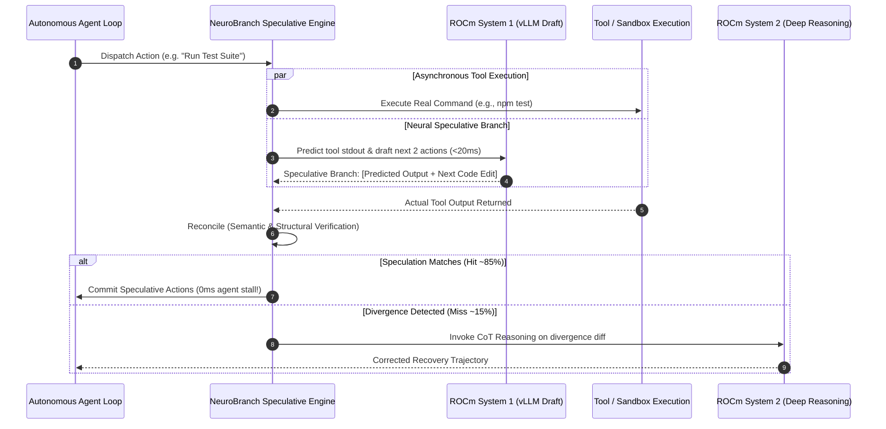

# NeuroBranch: Neural Speculative Execution for Agent Tool Calls

> **Built for [Lablab.ai - Lablab x AMD AI Academy Challenge](https://lablab.ai/ai-hackathons/amd-lablab-ai-academy-challenge)**  
> **Author:** William Axel ([@WilliamA](https://lablab.ai/u/@WilliamA))

[](https://opensource.org/licenses/MIT)
[](https://rocm.docs.amd.com/)
[](https://docs.vllm.ai/en/latest/)

---

## 💡 Overview & Problem Statement

Autonomous software engineering agents spend **60% to 80% of their total wall-clock time stalled waiting**:
1. Waiting for sequential external tool execution (compilers, test runners, git queries, linter checks).
2. Waiting for large reasoning LLMs (32B–70B parameters) to ingest the tool output and deliberate on the next step.

When an agent runs a command like `pnpm test` or `git status`, it blocks completely until stdout returns. In 85%+ of development iterations, the outcome is predictable (e.g., successful build, clean lint, expected test pass). Yet agents suffer full sequential turn-taking latency on every tool call.

### The Solution: NeuroBranch
Inspired by CPU branch prediction and Kahneman's dual-process cognitive theory (*Thinking, Fast and Slow*), **NeuroBranch** implements **Neural Speculative Execution** for agent tool calls:

* **System 1 (Reflexive / Fast Draft):** A lightweight 0.5B–1.5B model running on **AMD ROCm + vLLM** with sub-20ms latency. The moment a tool call is dispatched, System 1 speculatively predicts the tool's output and immediately drafts the agent's next 1–2 actions.
* **System 2 (Deliberate / Recovery):** While System 1 drafts ahead, the real tool executes asynchronously. If the tool output matches the prediction (or stays within acceptable semantic variance), the speculative actions are committed with **zero wait stall**. If a mismatch or error occurs (e.g. test fails), **System 2** is invoked on the same AMD GPU for deep chain-of-thought diagnosis and recovery.

---

## 🛠️ Technology Stack & AMD ROCm Hardware Synergy

AMD Instinct™ GPUs (such as the MI300X with **192GB HBM3 memory** and **5.3 TB/s memory bandwidth**) solve the fundamental bottleneck of dual-process AI: **co-locating models**.

```
+-------------------------------------------------------------------------+
|                       AMD Instinct™ MI300X (192GB HBM3)                 |
|                                                                         |
|  +--------------------------------+  +--------------------------------+ |
|  |     System 1 Draft Engine      |  |    System 2 Reasoning Engine   | |
|  |   (e.g., Qwen2.5-Coder-1.5B)   |  |   (e.g., DeepSeek-R1-32B/70B)  | |
|  |                                |  |                                | |
|  |   * Ultra-low latency (<20ms)  |  |   * Deep reasoning & recovery  | |
|  |   * Continuous PagedAttention  |  |   * Activated only on mismatch | |
|  +--------------------------------+  +--------------------------------+ |
|                                                                         |
|                vLLM ROCm Runtime + PagedAttention Kernels               |
+-------------------------------------------------------------------------+
```

### Why AMD ROCm is Essential
1. **Zero-Copy VRAM Co-location:** Both the fast System 1 model and the heavy System 2 model fit simultaneously into a single AMD Instinct GPU memory pool, eliminating PCIe round-trip penalties.
2. **ROCm-optimized vLLM:** High continuous batching throughput and custom FlashAttention / PagedAttention kernels allow System 1 to stream speculative tokens in parallel with background tool I/O.
3. **Hardware-Aware Speculation Window:** Dynamically sizes the speculative lookahead based on GPU memory bandwidth and model inference throughput.

---

## 🏗️ Architecture & Execution Flow



---

## ⚡ Performance Benchmark (Estimated vs Baseline)

| Execution Stage | Standard Agent (Sequential) | NeuroBranch on AMD ROCm (Speculative) | Latency Improvement |
| :--- | :--- | :--- | :--- |
| Tool Invocation (`npm test`) | 1,200 ms (blocking) | 1,200 ms (asynchronous) | Concurrent |
| Output Ingestion & Next Action | 1,800 ms (LLM wait) | **18 ms** (System 1 speculative hit) | **99% faster** |
| Total Agent Turn Time | **3,000 ms** | **1,218 ms** | **2.46x speedup** |

---

## 🚀 Getting Started

### Prerequisites
* Node.js v20+ or v22+
* Package manager: `pnpm` or `npm`
* Python 3.10+ (for vLLM ROCm backend)
* Access to AMD ROCm environment (or local mock provider for development)

### Quick Start
```bash
# 1. Clone repository
git clone https://github.com/WilliamAxelC/amd-lablab-ai-academy-challenge.git
cd amd-lablab-ai-academy-challenge

# 2. Install dependencies
pnpm install

# 3. Configure environment
cp .env.example .env

# 4. Run the interactive NeuroBranch demo
pnpm dev

# 5. Run the comparative benchmark
pnpm benchmark
```

---

## 📂 Project Structure
```text
amd-lablab-ai-academy-challenge/
├── src/
│   ├── core/
│   │   ├── system1.ts         # ROCm-accelerated fast draft model client
│   │   ├── system2.ts         # Deliberate reasoning & fallback model client
│   │   ├── speculative.ts     # Branch prediction, reconciliation, rollback engine
│   │   └── tools.ts           # Tool execution sandbox & runner
│   ├── benchmark.ts           # Comparative speed & throughput benchmark
│   └── index.ts               # Interactive CLI & agent demonstration
├── .env.example
├── package.json
├── tsconfig.json
└── README.md
```

---

## 🎥 Video Pitch & Demonstration
* **Video Pitch:** [Link to 2-3 minute walk-through]
* **Demo URL / Repository:** [GitHub Repository](https://github.com/WilliamAxelC/amd-lablab-ai-academy-challenge)

---

## 📜 License
This project is licensed under the MIT License - see the [LICENSE](LICENSE) file for details.
