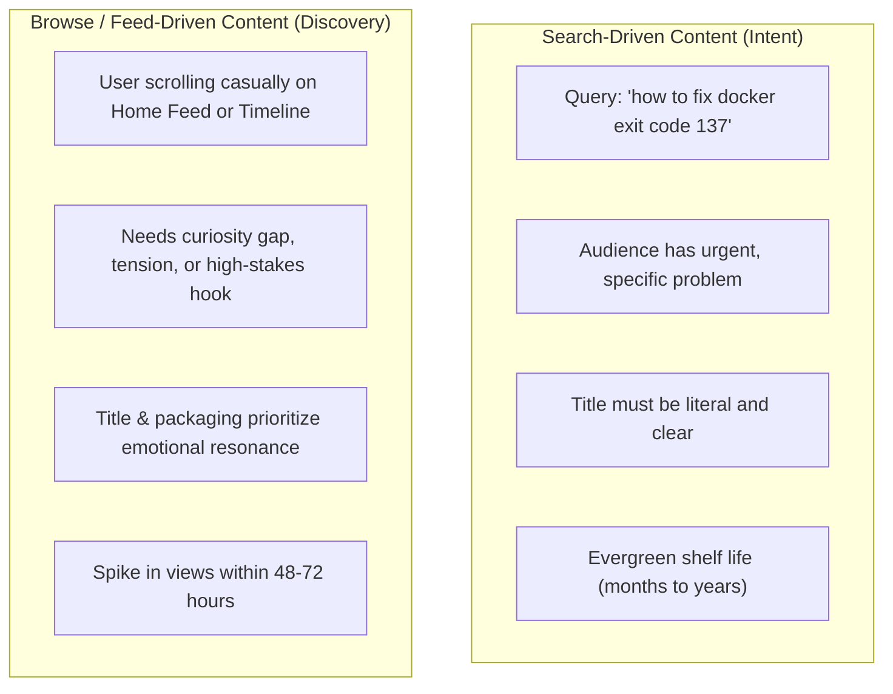

# Module 02: Ideation & Validation

Never stare at a blank cursor again. Systematic workflows for harvesting, scoring, and validating content ideas before spending hours producing them.

---

## 1. Search Demand vs. Browse Demand

Every platform runs on two distinct distribution algorithms:

- **Search-driven**: Gives you baseline consistent traffic. Great for building early subscribers and search authority.
- **Browse-driven**: Gives you viral upside and explosive audience expansion.

A healthy content calendar balances both: 70% browse-optimized concepts to grow, 30% search-optimized guides to anchor search equity.

---

## 2. Signal Mining Techniques

Ideas should not come from a spark of random shower inspiration. They should come from documented audience friction.

### Technique A: Reddit Pain Point Extraction
1. Visit subreddits where your avatar hangs out (e.g. `r/webdev`, `r/datascience`, `r/entrepreneur`).
2. Search keywords like:
   - `"why is it so hard to"`
   - `"is anyone else sick of"`
   - `"how do you actually"`
   - `"wasted 4 hours"`
3. Sort by Top (Past Year) or search within comments. The most upvoted comments are raw gold for video titles and post hooks.

### Technique B: Competitor Comment Teardowns
1. Find top creators in your space. Locate their best-performing videos from the last 6 months.
2. Read the top 50 comments.
3. Look for:
   - *"I loved the video, but I still don't understand how X works."* (An unanswered gap you can answer).
   - *"Wish you went deeper into Y."* (Your next video topic).
   - *"This broke for me when I upgraded to version Z."* (A fix tutorial).

### Technique C: The "Logbook of Daily Annoyances"
Keep an open notes file on your phone or desktop. Whenever you hit a bug, spend 20 minutes debugging a weird CLI flag, or learn a subtle workflow trick: write it down immediately. If you struggled with it today, thousands of others are struggling with it right now.

---

## 3. The 3-Filter Validation Test

Before committing 10 hours to script and edit a video or deep dive, run the idea through these three filters:

| Filter | Key Question | Threshold |
| :--- | :--- | :--- |
| **Tension / Stakes** | Why does this matter *now*? What bad thing happens if the viewer ignores this? | Must have a clear cost of inaction. |
| **The 5-Second Hook** | Can you write a one-sentence hook that makes a peer stop scrolling? | If you cannot hook in one sentence, the concept is too soft. |
| **Visual / Demonstration Potential** | Can you *show* this visually, or are you just lecturing? | Video demands demonstrations, side-by-side comparisons, or visible charts. |

---

## 4. Title & Thumbnail First (The YouTube Packaging Rule)

For YouTube videos, **never write the script before writing the title and thumbnail concept**.
If you cannot come up with at least 3 compelling title and thumbnail pairings that you would personally click, do not shoot the video. Packaging defines your ceiling; content defines your floor.
