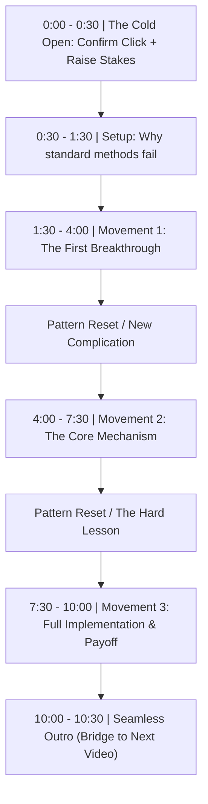

# Module 03: Writing & Scripting

Writing is the bedrock of all content. Whether you are speaking on camera, producing voiceovers for animated B-roll, or publishing text posts on LinkedIn and X, strong scripting determines whether people finish your content.

---

## 1. Writing for the Ear vs. Writing for the Eye

| Attribute | Written for the Eye (Articles, Docs) | Written for the Ear (Video, Podcasts) |
| :--- | :--- | :--- |
| **Sentence Length** | Long compound sentences with clauses. | 6 to 12 words maximum per sentence. |
| **Punctuation** | Semicolons, colons, formal commas. | Ellipses, question marks, stage directions `[PAUSE]`. |
| **Vocabulary** | Formal technical terms. | Conversational equivalents. Words you say at dinner. |
| **Pacing** | Reader controls the reading speed. | You control the viewer's attention speed. |

When scripting for video, always read your draft out loud with a timer running. If your tongue trips over a word, cut that word. If you run out of breath before a period, split the sentence.

---

## 2. YouTube Long-Form Architecture

Most viewers drop off within the first 60 seconds. A proven narrative structure combats this drop-off:

### The 4 Lethal YouTube Intro Mistakes:
1. **The Ego Greeting**: *"Hey guys, welcome back to my channel! If you're new here, my name is..."* (Immediate viewer drop).
2. **The Slow Channel Bumper**: 5-second 3D spinning logo with generic EDM music.
3. **The Delayed Promise**: Spending 3 minutes talking about your weekend before getting to the title's topic.
4. **The "Wrap-Up" Warning**: Saying *"In conclusion..."* or *"To wrap this up..."* triggers an instant retention nosedive. Never signal that the video is ending until the final 5 seconds.

---

## 3. Short-Form Scripting (Shorts / Reels / TikTok)

Short-form videos require a 3-layer hook in the first 2.5 seconds:
1. **Auditory Layer**: What you say (the verbal hook).
2. **Visual Layer**: What the viewer sees (movement, an unusual object, high contrast).
3. **Text Layer**: The headline on screen (reinforces the verbal hook for sound-off scrollers).

### Pacing Rule for Short-Form:
- Switch visual stimuli every 2.5 to 3.5 seconds (cut, zoom, B-roll, on-screen text, sound effect).
- Deliver 1 single insight, not 5. Depth on one specific trick beats shallow surface summaries.

---

## 4. Text-Based Posts (LinkedIn & X)

On text feeds, the first 1-2 lines do 90% of the work.

- **LinkedIn**: You must win the click on `...see more`. Treat the first two lines like a miniature headline and subheadline.
- **X (Twitter)**: The first tweet of a thread must promise an undeniable transformation or a curated treasure chest that would take 40 hours to compile independently.
- **Formatting**: Use whitespace aggressively. Never post a block of text thicker than 3 lines on mobile.
