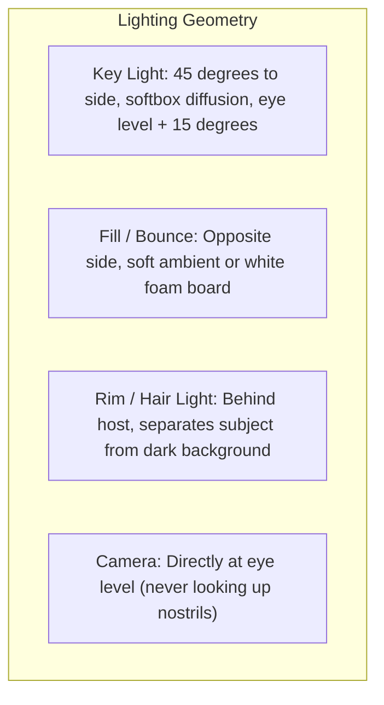

# Module 04: Production & Editing

How to record clean audio, set up proper lighting, and edit for high viewer retention without spending thousands on gear.

---

## 1. The Audio Rule: 60% of Video is Sound

Viewers tolerate mediocre 1080p camera quality, but they abandon videos with hollow, echoey, or clipping audio within 15 seconds.

### Core Audio Principles:
- **Proximity is King**: The closer the microphone capsule is to your mouth (4 to 6 inches), the higher the signal-to-noise ratio. A $60 microphone 4 inches from your mouth sounds better than a $1,000 shotgun mic 4 feet away.
- **Tame Room Echo**: Soft surfaces absorb sound. Blankets, rugs, curtains, and bookshelves kill high-frequency slap echo. If your room has bare drywall and hardwood floors, hang a heavy blanket behind your camera.
- **Gain Staging**: Set your recording levels so spoken peaks hit between **-12 dB and -6 dB**. Never let audio hit 0 dB (digital clipping cannot be repaired in post-production).
- **Audio Processing Chain**:
  1. High-pass filter (cut frequencies below 80 Hz to eliminate HVAC rumble).
  2. Noise suppression (subtle gate or AI voice isolation).
  3. Parametric EQ (slight cut around 300-500 Hz for mud, slight boost around 3-5 kHz for vocal presence).
  4. Compressor (smooth out dynamic volume spikes).
  5. Limiter set to -1.0 dB true peak.

---

## 2. Lighting & Camera Setup on a Budget

You do not need an expensive mirrorless cinema rig. A modern smartphone or 1080p/4K webcam produces sharp footage if lit properly.

### Camera Rules:
- **Lock Exposure & White Balance**: Auto-exposure hunting ruins footage whenever you shift in your chair or move your hands. Lock both before hitting record.
- **Framing**: Keep your eyes along the upper horizontal third line. Leave a small amount of headroom above your head.
- **Screen Recording**: Clean up your desktop. Hide bookmark bars and notification docks. Set your code editor font size to at least 18pt to 22pt so mobile viewers can read every line.

---

## 3. Editing for Retention (The Cutting Room Floor)

Editing is subtraction. If a sentence does not advance the argument, raise the stakes, or entertain, delete it.

### The 4 Phases of Modern Video Editing:
1. **Phase 1: The A-Roll Rough Cut**
   - Import all footage. Ripple delete every dead pause, throat clear, stutter, and repeated take.
   - Tighten gaps between thoughts: leave no more than 0.2 to 0.4 seconds of silence between sentences.
2. **Phase 2: J-Cuts & L-Cuts**
   - Avoid hard simultaneous audio-video cuts. A J-cut brings in the next audio a split-second before the visual switches. An L-cut lets the speaker's voice trail over the next piece of B-roll.
3. **Phase 3: Visual Pacing (Pattern Interrupts)**
   - Add punch-ins (110% to 115% scale jump cut) on emphasized phrases.
   - Insert relevant B-roll, UI animations, diagrams, or screen captures every 4 to 7 seconds during long talking-head stretches.
4. **Phase 4: Sound Design & Background Bed**
   - Add tactile sound effects: subtle page turns, clicks, whooshes, and sub-drops.
   - Background music must sit at **-22 dB to -26 dB** relative to dialogue. If the viewer has to strain to hear your voice over the music track, lower the music immediately.

---

## 4. Packaging: The Rule of 3 for Thumbnails

Every high-CTR thumbnail adheres to the Rule of 3:
1. **Element 1**: The focal subject (an expressive human face or recognizable hero icon).
2. **Element 2**: The tension object (a red error code, broken pipeline diagram, or visual contrast).
3. **Element 3**: Text (maximum 2 to 4 bold words; never repeat the exact title words).

**The Mobile Shrink Test**:
Shrink your thumbnail to 100px width on your monitor. If you cannot understand the visual story at that size in 1 second, simplify the composition.
