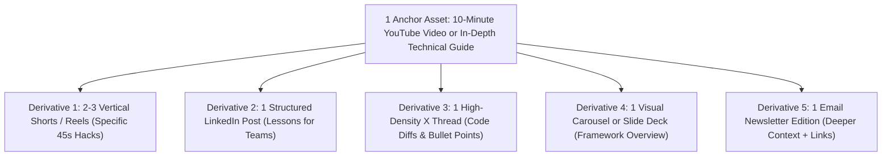

# Module 05: Distribution & Repurposing

Stop treating every social network as a separate content hamster wheel. Master the 1-to-5 content flywheel to extract maximum reach from a single core asset.

---

## 1. The Content Flywheel (1 Anchor Asset to 5 Derivatives)

Creating from scratch every day leads directly to burnout. Instead, produce one comprehensive anchor asset each week or two weeks, then splinter it across platforms natively.

---

## 2. Platform Algorithm Mechanics (The Rules of Each Arena)

Each platform evaluates attention differently. Understand the core signal each algorithm optimizes for:

### A. YouTube (Long-Form)
- **Primary Metrics**: Click-Through Rate (CTR) + Average View Duration (AVD) / Average Percentage Viewed (APV).
- **Secondary Metric**: End screen click-through (keeping the user on the platform).
- **Golden Rule**: Deliver on the thumbnail's promise within the first 15 seconds.

### B. YouTube Shorts & Instagram Reels / TikTok
- **Primary Metric**: View completion rate and loop count (needs 85%+ completion to trigger broad algorithmic distribution).
- **Secondary Metric**: Shares (sending to a friend via DM) and Saves (bookmarking to re-watch later).
- **Golden Rule**: Pacing must remain relentless. The final second should cleanly bridge back into the opening hook.

### C. LinkedIn
- **Primary Metric**: Dwell time (how many seconds a user spends reading your post before scrolling).
- **Secondary Metric**: Meaningful comments from industry peers.
- **Golden Rule**: Put the value on the platform. Avoid dropping outbound links in the post body (outbound links frequently trigger algorithmic distribution penalties). Keep readers engaged on LinkedIn.

### D. X (Twitter)
- **Primary Metric**: Engagement velocity (replies, retweets, and bookmarks in the first 30 minutes).
- **Secondary Metric**: Retweets with comment (quote tweets).
- **Golden Rule**: First tweet must stand alone as a valuable insight. Thread replies should contain dense, screenshot-backed value.

---

## 3. The Anti-Pattern: Lazy Cross-Posting

Do not drop a raw YouTube link into LinkedIn with the caption *"New video out! Check it out!"*
This fails because:
1. The platform algorithm suppresses posts that send users off-site.
2. Users on LinkedIn or X are in a fast-scrolling text mode; they do not want to stop and watch a 15-minute video right now.

Instead, extract the core framework from the video, write it as a standalone 200-word post, and mention the full video in the comments or at the very end as a resource for those who want deep implementation details.
