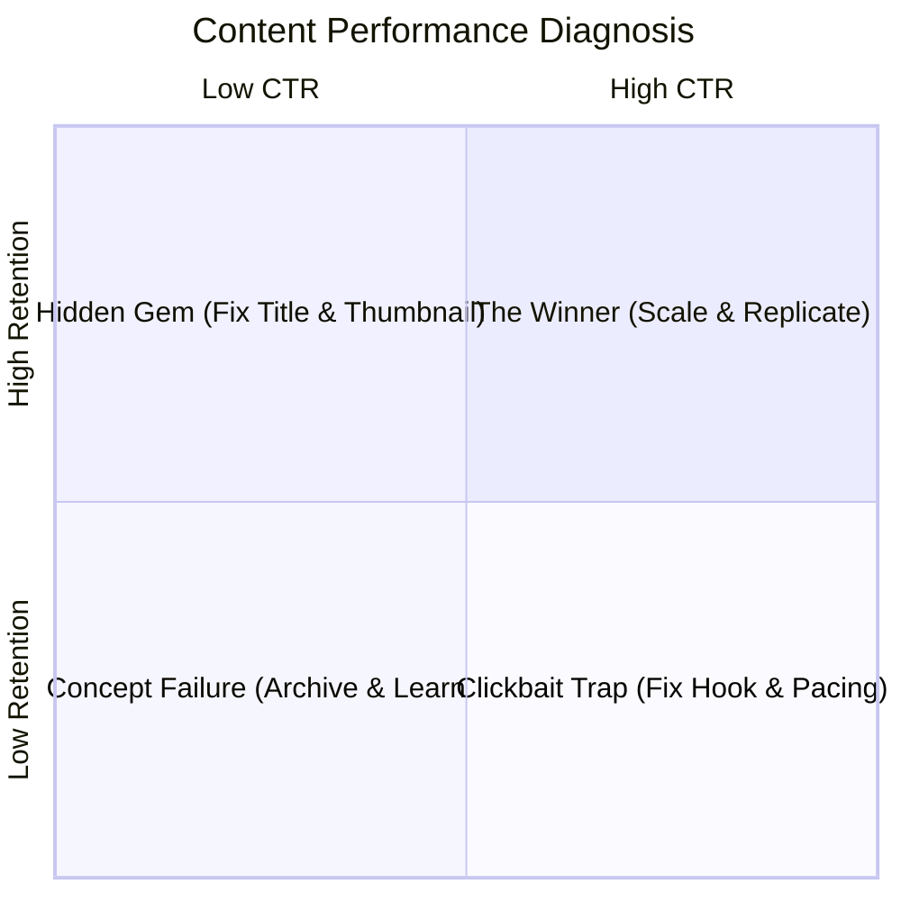

# Module 06: Analytics & Iteration

How to diagnose performance data, fix underperforming assets, and build a sustainable creator feedback loop without emotional burnout.

---

## 1. The 2x2 Content Diagnosis Matrix

When a piece of content underperforms, do not guess what went wrong. Diagnose it using the Click-Through Rate (CTR) and Average View Duration (AVD) matrix:

### Diagnosing Your Content:

1. **High CTR + Low Retention ("Clickbait Trap")**
   - **Symptom**: Lots of clicks, but viewers bounce within 45 seconds.
   - **Cause**: The packaging made a promise that the video failed to address quickly, or the intro was slow and rambling.
   - **Fix**: Re-cut the first 30 seconds. Confirm the topic immediately without channel greetings.

2. **Low CTR + High Retention ("Hidden Gem")**
   - **Symptom**: Few people click, but those who do watch the entire video or read the whole thread.
   - **Cause**: The content is fantastic, but the packaging (title, thumbnail, social hook) is boring or confusing.
   - **Fix**: Do not touch the video! Immediately redesign the thumbnail and test 2 new titles. You can resurrect a dead video within 48 hours with a packaging overhaul.

3. **High CTR + High Retention ("The Winner")**
   - **Symptom**: High click rate and viewers stay to the end.
   - **Cause**: Perfect alignment of market demand, curiosity, and execution.
   - **Action**: Double down immediately. Produce a follow-up video, part two, or adjacent topic within 14 days.

4. **Low CTR + Low Retention ("Concept Failure")**
   - **Symptom**: Nobody clicks, and those who do leave quickly.
   - **Cause**: Weak topic or saturated angle with poor execution.
   - **Action**: Do not obsess over it. Extract whatever worked, archive the project, and move to the next concept.

---

## 2. Reading the YouTube Retention Curve

Open your YouTube Studio analytics tab and study the retention line:

- **The 0:00 to 0:30 Drop**: Aim for at least **70% of viewers still watching at the 30-second mark**. If you drop below 60%, your cold open is too slow.
- **Sudden Vertical Drops**: Look at the exact timestamp where the curve drops sharply. Did you start a boring tangent? Did you lecture about history instead of showing code? That is your cue to cut tighter in future edits.
- **Small Spikes (Rewinds)**: A spike indicates viewers rewound the video. Look at what happened: was it an intricate diagram, a fast code snippet, or a funny visual gag? Build more of that into your next project.

---

## 3. Burnout Defense & Creator Psychology

Creator burnout does not happen from working hard. It happens from **working hard with zero predictable feedback loop and erratic context-switching**.

### Safeguards for Longevity:
- **Batch Tasks by Mode**:
  - Monday: Ideation and research (Creative generation mode).
  - Tuesday: Scripting and writing (Deep focus mode).
  - Wednesday: Recording (High energy presentation mode).
  - Thursday: Editing and sound design (Craftsman mode).
  - Friday: Packaging, scheduling, and distribution.
- **Decouple Identity from Algorithm Spikes**: The algorithm is an automated matching engine connecting videos to viewers, not a report card on your human intelligence or worth. Treat view drops as debugging telemetry, exactly like debugging an HTTP 500 error in code.
