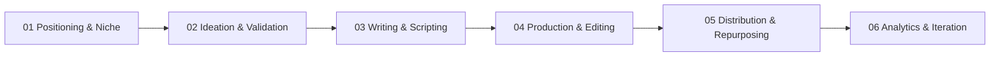

# Content Creation Mastery: Full-Stack Curriculum

A practical, hands-on curriculum for modern multi-platform content creation. Covers video production (YouTube long-form, short-form Reels/Shorts/TikTok), social writing (LinkedIn, X/Twitter), and distribution flywheels.

---

## Curriculum Roadmap

---

## Module Index & Progress Tracker

Track your progress by marking completed modules and practical drills:

| Module | Core Topics | Key Deliverables | Status |
| :--- | :--- | :--- | :---: |
| [01 Positioning & Niche](file:///home/agent/orca/learnings/content-creation/01-positioning-and-niche/guide.md) | Unfair advantage, audience avatar, 3 content pillars | Niche statement, avatar dossier, pillar matrix | [ ] |
| [02 Ideation & Validation](file:///home/agent/orca/learnings/content-creation/02-ideation-and-validation/guide.md) | Signal hunting, search vs browse demand, hook banks | 30-idea backlog, 3 validated concepts | [ ] |
| [03 Writing & Scripting](file:///home/agent/orca/learnings/content-creation/03-writing-and-scripting/guide.md) | Hook psychology, retention loops, long-form vs shorts | 10 hooks, 1 long script, 1 short script, 1 X thread | [ ] |
| [04 Production & Editing](file:///home/agent/orca/learnings/content-creation/04-production-and-editing/guide.md) | Audio staging, 3-point lighting, pacing, packaging | Audio test recording, 60s cut, thumbnail sketches | [ ] |
| [05 Distribution & Repurposing](file:///home/agent/orca/learnings/content-creation/05-distribution-and-repurposing/guide.md) | The 1-to-5 content flywheel, platform algorithms | Repurposing workflow, cross-platform batch plan | [ ] |
| [06 Analytics & Iteration](file:///home/agent/orca/learnings/content-creation/06-analytics-and-iteration/guide.md) | Retention curves, CTR vs AVD diagnostics, burnout defense | Post-mortem audit sheet, 90-day cadence calendar | [ ] |

---

## How to Work Through This Track

1. **Read the Guide First**: Open `guide.md` in the current module to internalize the mental models and pitfalls.
2. **Execute the Drills**: Work through `exercises.md`. Fill out your answers and save your scripts directly in your notes or dedicated folders.
3. **Ship Real Assets**: This curriculum is not just theory. Every module ends with assets you can publish immediately.
4. **Iterate with Data**: After publishing, log metrics in Module 06 to refine your scripting and packaging.

---

## Automated Animation Workflow

For the fully automated AI vector animation pipeline and Pablo Stanley asset library, see the dedicated repository:
👉 [AI-nimate (github.com/Cuang-dev/AI-nimate)](file:///home/agent/orca/AI-nimate)

